# I keep receipts: a portfolio where every claim proves itself

> **Before you submit (delete this block):**
> 1. Open every receipt and click its evidence links yourself. "How I built it" says you reviewed them, so make that true.
> 2. Read the whole post aloud once and change anything that doesn't sound like you.
> 3. Add the challenge's tag when you post it on AWS Builder Center; the challenge page names it.
> 4. The images load from GitHub, so they show up anywhere Markdown images work. If the editor wants uploads instead, upload `docs/architecture.png` and the PNGs from `docs/screenshots/` in the same order.

**Live site:** https://main.d1nj3qfdmf673t.amplifyapp.com · **Code:** https://github.com/MdIbuA/ibu-receipts (MIT) · **Hosted on:** AWS Amplify Hosting

Most portfolios ask you to take their word for it. Mine prints receipts.

Every underlined claim on my portfolio (an R² score, a tool count, a latency, a job title) prints a till-style receipt: the evidence behind it, down to the exact file and line at a pinned commit; how it was measured; and **the catch**, the part that makes me look worse. Writing those receipts caught me out four times: four places where my own write-ups disagreed with my code. Those receipts now print the correction.

Then I turned the idea around. A recruiter can paste a job description, and the printer itemizes it against what I can prove, including what I can't. My résumé prints the same way. You can even ask the printer questions about me: Chit, a receipt printer with a face, answers only with receipts. AWS will re-check any receipt live, on request, and the page's own receipt, which names the build and commit you're looking at, is written by the Amplify build, not by me.

That's my tech superpower: I keep receipts.

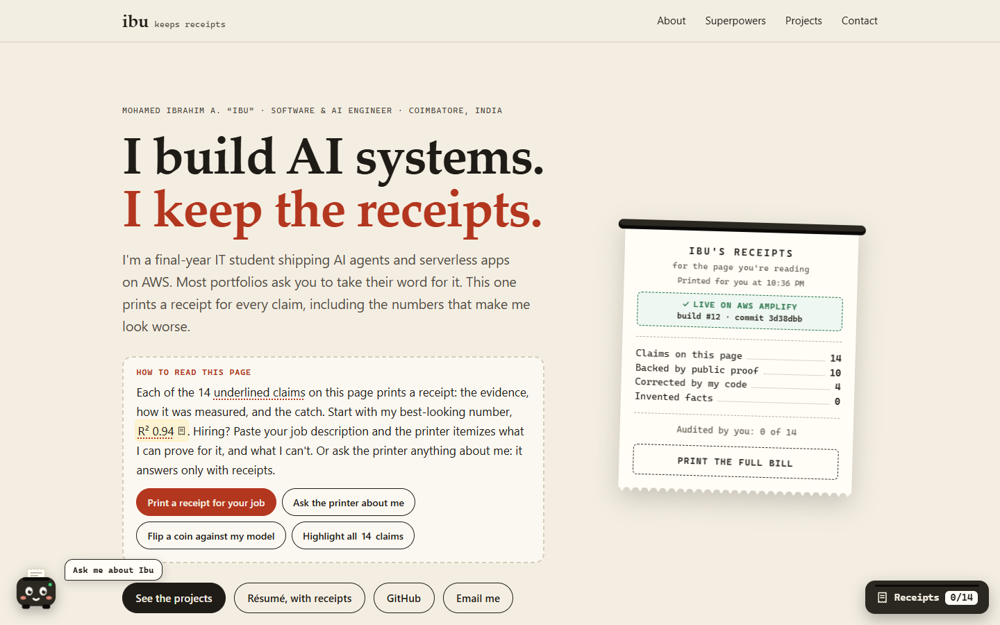

## Try it in 30 seconds

- **Open a receipt:** [R² 0.94](https://main.d1nj3qfdmf673t.amplifyapp.com/#r-cryptopulse), my best-looking number. Read its catch, then flip a coin against it.
- **Ask the printer:** [open Chit](https://main.d1nj3qfdmf673t.amplifyapp.com/#ask) and ask whether I know Kubernetes. Then try to make it say something I can't prove.
- **Get a receipt for a job:** [a sample cloud intern role](https://main.d1nj3qfdmf673t.amplifyapp.com/#job-cloud-intern), or [paste your own](https://main.d1nj3qfdmf673t.amplifyapp.com/#job).
- **Read my résumé, with receipts:** [/resume/](https://main.d1nj3qfdmf673t.amplifyapp.com/resume/), with the PDF one click away.
- **Ask AWS to check me:** open [any receipt](https://main.d1nj3qfdmf673t.amplifyapp.com/#r-supermarket) and press **Re-check with AWS Lambda**.

---

## Why receipts are my superpower

I'm Ibu, a final-year B.Tech IT student in Coimbatore. I build AI agents and serverless apps on AWS, and I keep coming back to one rule: **the model never gets to invent a fact.** In my Supermarket Ops Agent, Claude can't make up a price, because every number comes out of Postgres through one of 30 typed tools. My CryptoPulse write-up prints its 47.93% direction accuracy right next to the R² of 0.94, because a coin flip gets 50%.

So for this challenge I asked: what if my portfolio followed the same rule? It can't claim anything it can't prove, and where the proof runs out, it says so. Of the 14 claims on the page, 10 are backed by public proof, 3 only partly, and 1 is self-reported. The page prints those numbers itself.

## What the page does

### Every claim prints a receipt

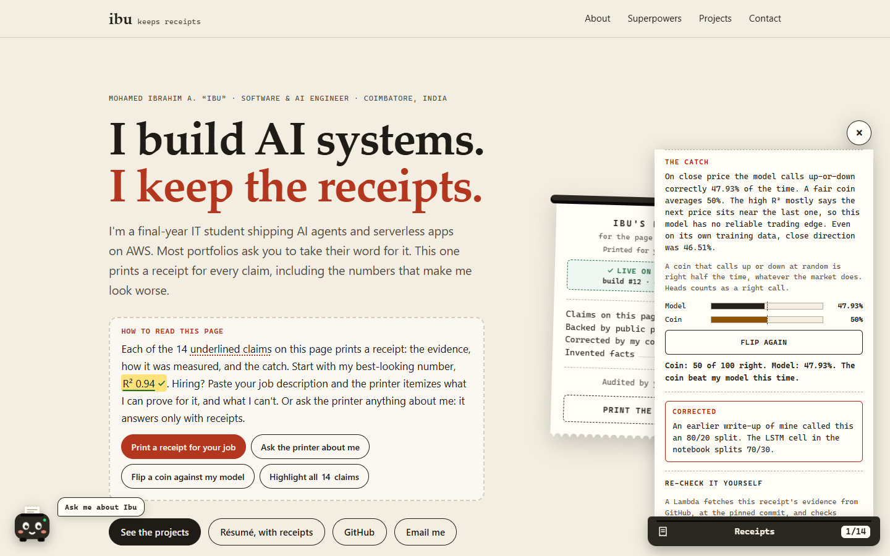

Click `30 typed tools` and a receipt feeds out of a small printer docked in the corner. It itemizes the claim (`Tools in ALL_TOOLS ..... 30`), links the evidence at the exact file and line on GitHub, says how the number was measured, prints the catch, and stamps itself **Verified**, **Partial** or **Self-reported**. Every link into a project's code is pinned to a commit, so a receipt is a frozen record: if I edit a README later, the line it points at can't drift.

### Corrections are printed, not hidden

Building the receipts meant checking every sentence against the code, and four of my claims failed:

- My Supermarket README said 32 tools. The registry holds 30.
- An old CryptoPulse write-up said 80/20 split. The notebook's LSTM splits 70/30.
- Tiny Tale Toy's README names Nova Lite in places. The code defaults to Ministral 3 8B.
- Voter Saathi's README credits Gemini. Its server tries three free OpenRouter models first.

Those receipts carry a red **Corrected** box. I'd rather show you where I was wrong than have you find it.

### Ask the printer: meet Chit

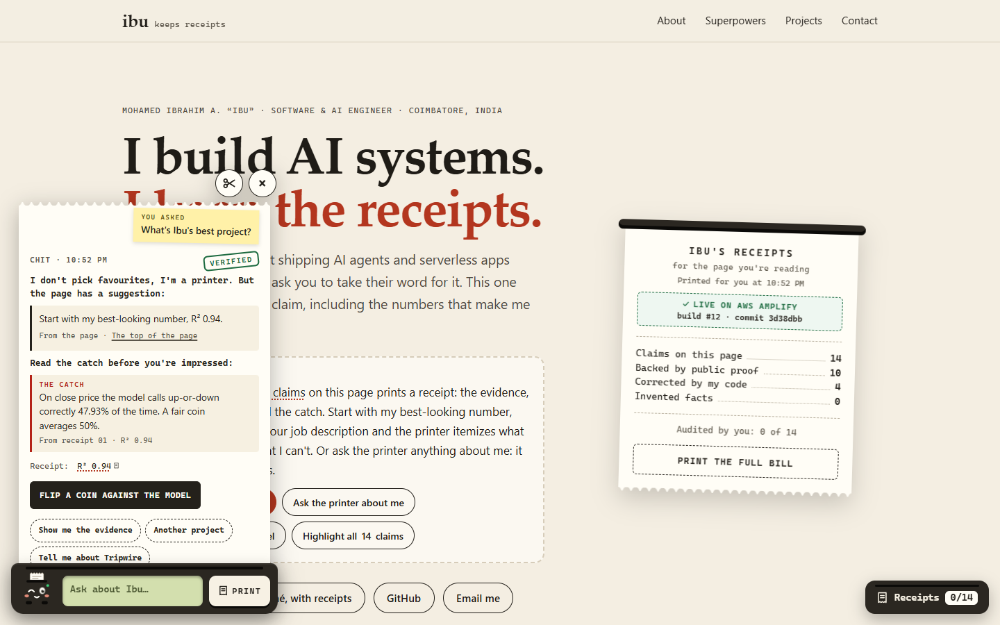

Most portfolios have a chatbot now, and most of them would happily make something up about their owner. Mine is the receipt printer, with a face. Chit waits in the corner, and each time the page opens it hops up and says hello in a speech bubble, then lets the bubble go. Ask it "Does Ibu know Kubernetes?" or "What is Ibu bad at?", and it prints the answer on a roll of paper: lines quoted word for word from the page and the receipts, each naming where it came from, with a button that prints the full receipt. Your question sticks to the roll as a yellow note.

Chit can't invent anything, because it has no model. It matches your question to what's on file: the page's own lines, the 14 receipts and the 114-skill map. Ask about Kubernetes and it prints **No receipt** with a worried face, because I've only studied it. Ask for my best project and it says it doesn't pick favourites, then quotes the page's suggestion and the catch that comes with it. Try to jailbreak it and it points you to Tripwire, my prompt-injection project. Three rules hold it, and the tests check all three on every build: every quote must still be on the page word for word, Chit's own words never carry a number, and every question it suggests must get a real answer. It all runs in your browser, so nothing you type is sent or saved.

### A receipt for your job

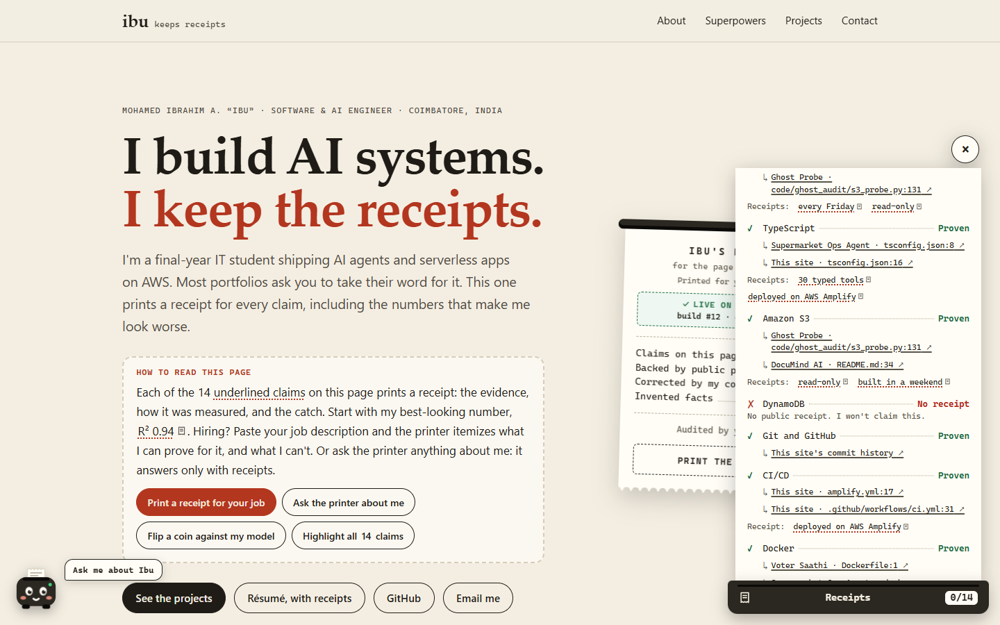

Recruiters arrive with a role in mind, so the page answers about that role. Paste a job description, or pick one of three samples, and the printer reads its must-haves and nice-to-haves, then itemizes each requirement against a map of 114 skills. Each one prints as **Proven**, linked to the file and line that proves it; **Partial**, with the reason; or **No receipt**: "I won't claim this." The totals end with *Invented to fit your job: 0*. It all runs in the browser, so nothing you paste is sent or saved.

### A résumé with receipts

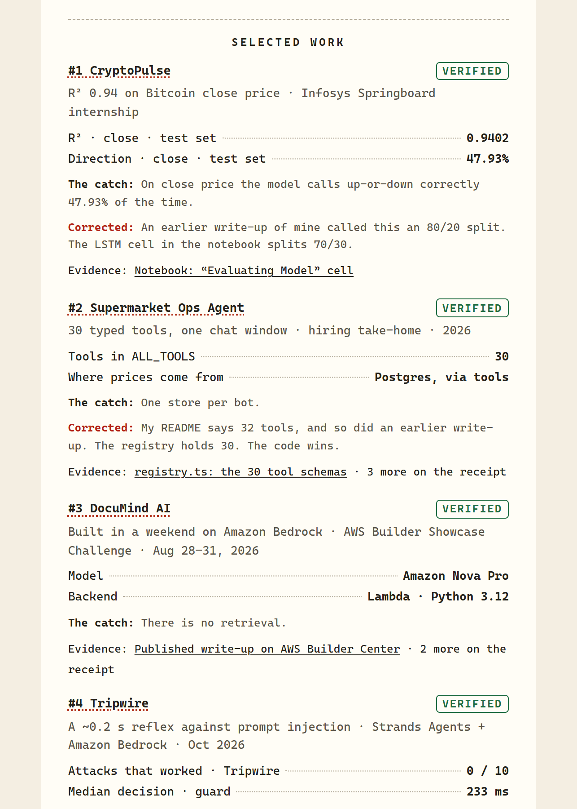

The hero's **Résumé, with receipts** button opens my résumé printed as one long receipt, with a PDF to download. A script prints it from the same typed claims as the page, so it can't say anything a receipt doesn't: every claim links to its live receipt, leads with its headline numbers and prints its catch. If the page or the PDF ever drifts from the data, a test fails.

### The page's own receipt, written by AWS

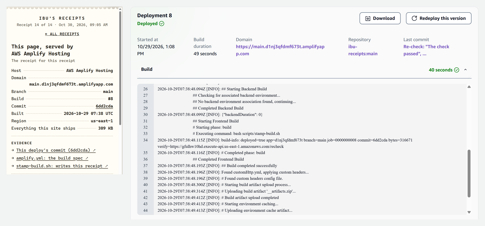

The hero's receipt names the Amplify build and commit you're looking at, for example "build #12 · commit 3d38dbb". I don't type those numbers. The Amplify build stamps them into the page at deploy time, so the build in the Amplify console and the build on the page are the same one.

### Re-check it yourself, live on AWS Lambda

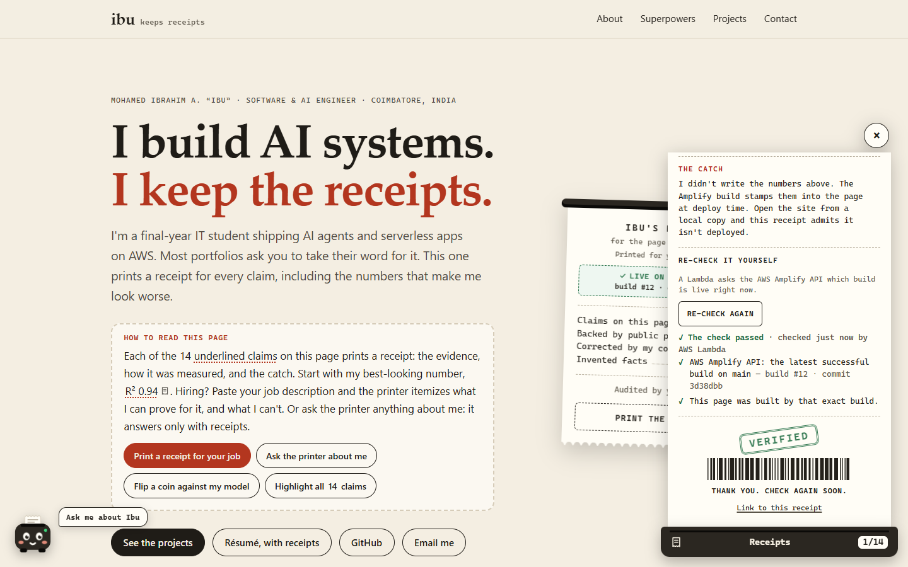

Every receipt ends with **Re-check with AWS Lambda**. A Lambda fetches that receipt's evidence from GitHub, at the commit it cites, and runs its checks again while you watch: the registry still holds 30 tool schemas, the notebook still prints 47.93%, and the old README still says 32, so the correction still stands. On the page's own receipt, it asks the AWS Amplify API which build is live, and the page confirms it was built by that exact build.

### The details that make it feel like paper

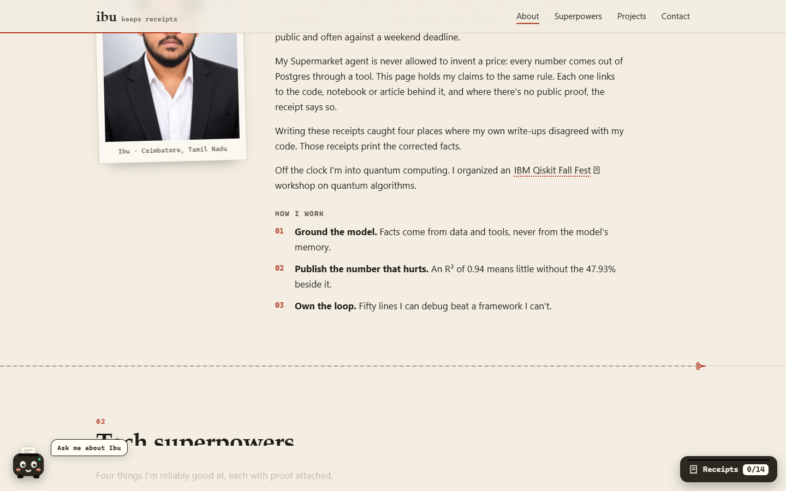

- **The page prints itself as you scroll.** Scissors cut each section's top edge into a perforation, section numbers are stamped, titles print line by line and cards feed up a beat apart. It's CSS scroll-driven animation, so the scroll position is the clock and no script decides what shows.
- **Coin vs. model.** One button races a coin, flipped 100 times, against my model's 47.93%. The coin often wins, and the receipt says so.
- **The itemized bill** totals the page: claims, proof, corrections, invented facts (0) and how many receipts *you* have audited.
- **Your visit, on a receipt.** On wide screens, a small receipt in the margin prints a line for each section you stay to read, and stamps "Read in full" at the end.

### It never gets in the way

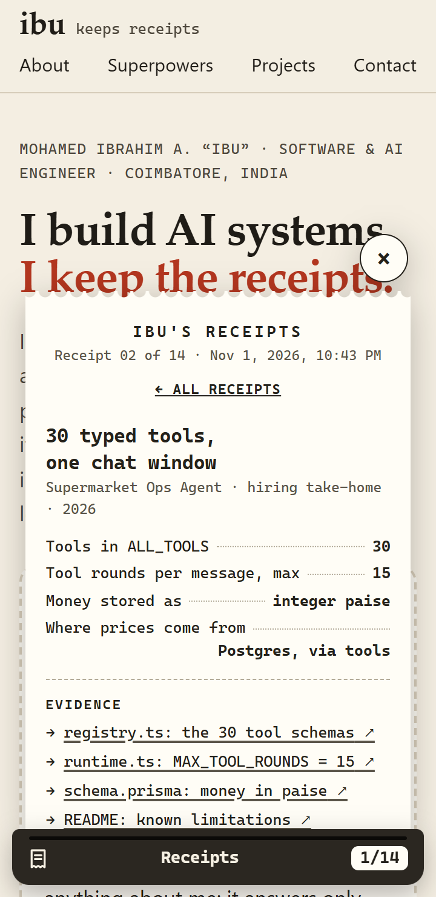

Under the receipts sits a normal portfolio, with About, Tech superpowers, Projects & achievements and Contact. The receipt panel is non-modal and docked to the side, so a recruiter can read straight through without touching it. On phones it's a bottom sheet under an untouched header. Chit docks in the other corner: on a wide screen a receipt it cites prints beside it, and on a phone the two take turns, with a "Back to Chit" button on the receipt. Without JavaScript, every claim is a plain link to its evidence. Reduced motion turns every animation off, and axe reports no WCAG 2.2 AA violations at phone and desktop sizes, with or without a receipt or Chit open.

## How it runs on AWS

The portfolio itself is static, so it can't break during judging. AWS does three jobs around it: it builds and serves the page, it testifies to which build is live, and it re-checks the evidence on demand.

| Service | Its job here |
|---|---|
| **AWS Amplify Hosting** | CI/CD from GitHub. Every push installs, type-checks, runs 179 tests, compiles and deploys, so a broken rule stops the deploy. Build variables write the page's own receipt, `customHttp.yml` adds a strict content security policy and security headers, and the site is served over HTTPS from Amplify's CDN. |
| **Amazon API Gateway** (HTTP API) | One route, `GET /recheck`, throttled to 5 requests a second (burst 10), with CORS limited to the site |
| **AWS Lambda** (Python 3.12, arm64) | 31 checks across 13 claims, plus the live-build check. It only fetches the URLs in its own list, and caches results for 5 minutes. |
| **AWS IAM** | Beyond writing its logs, the Lambda can do exactly one thing in my account: `amplify:ListJobs` on this app's `main` branch |
| **Amazon CloudWatch Logs** | One JSON line per re-check (`claim`, `ok`, `ms`), kept 30 days: an audit trail of the audits |
| **AWS CloudFormation** (via AWS SAM) | The whole re-check stack is code, in `infra/recheck/template.yaml` |
| **AWS Budgets** | A zero-spend budget that emails me if actual spend passes $0.01 |

### Decisions I made on purpose

- **Static first.** The page never waits on the API. If the checker is down, every receipt still stands on its stored evidence, and a failed check says "couldn't check", never "failed".
- **Least privilege wherever I could.** One IAM permission, one route, a hard-coded list of URLs, CORS for one origin, and a content security policy that allows exactly one inline script, by its hash.
- **Throttled, not just cheap.** Lambda function URLs are simpler, but they can't be throttled. An HTTP API can.
- **No database.** Nothing here needs state, and CloudWatch already keeps the audit trail.
- **A chatbot with no model.** An "ask about me" bot that lets a model write the answers could invent facts about me, which breaks the one rule this site exists for. So Chit has no model and no prompt: it quotes what's on file, in the browser, for free, with nothing to jailbreak. Where a model does help, it should be grounded, so I built an Amazon Bedrock reader (Nova Micro) that reads job descriptions more closely and checks every quote it returns against the text. My new account answers "Operation not allowed" for every Bedrock model, so the browser reader ships today, and the Bedrock reader waits, built and tested, on the [`bedrock-reader`](https://github.com/MdIbuA/ibu-receipts/tree/bedrock-reader) branch.

The console, with my account ID hidden:

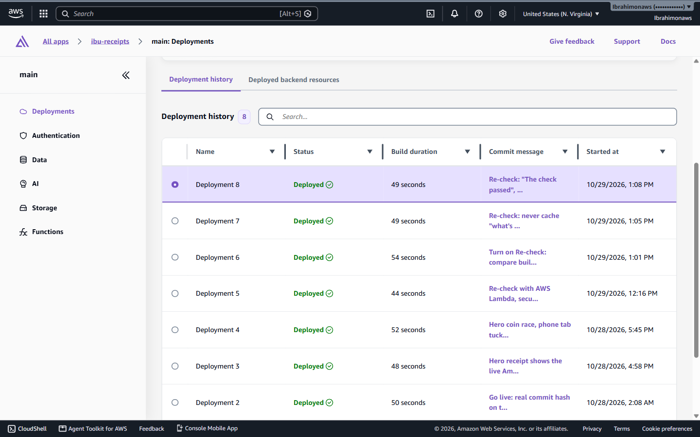

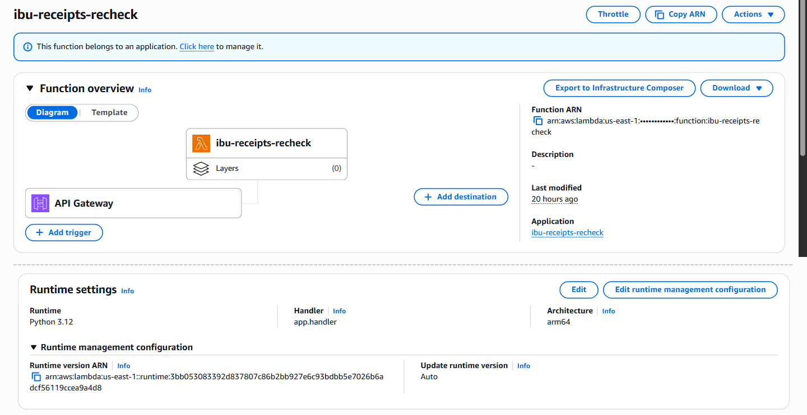

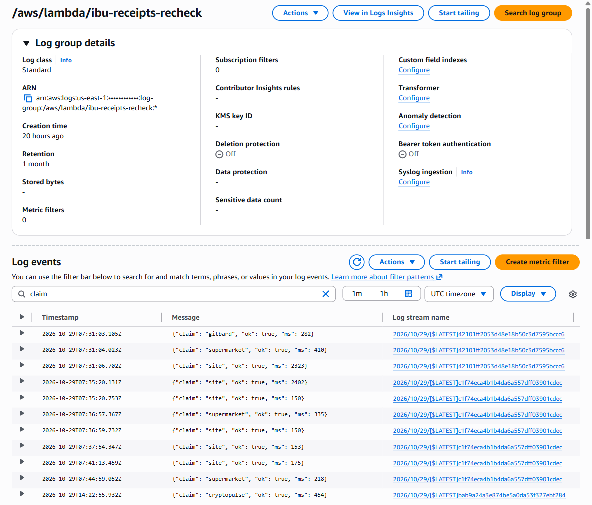

## How I built it

1. **Choosing the idea, with my coding agent.** I used **Claude Code** as my coding agent. I gave it the challenge rules, the rubric and my old portfolio, and asked for ideas drawn from me rather than from a template. Of its three (receipts, a quantum circuit that "measures" me, and a fantasy retelling of my commits), receipts was the one only I could have.
2. **The evidence pass.** The agent read my public repos file by file (notebook outputs, tool registries, IAM policies, test counts, SAM templates) and turned every claim into a receipt pointing at the exact line. That's where the corrections surfaced. I reviewed every receipt against its source before shipping.
3. **A page that works without the feature.** The base portfolio is plain HTML and CSS. The receipts layer upgrades it when JavaScript runs, so the page never depends on it.
4. **Amplify, and a bug the site caught in itself.** I connected the repo to Amplify Hosting. Build #1's own receipt printed "HEAD" instead of a commit hash, because Amplify's first build reports its commit that way. The stamp script now resolves the real hash, and every build since has testified for itself.
5. **Receipts that re-check themselves.** A link still asks you to trust me, so I added the smallest backend that could verify instead: one HTTP API, one Lambda and one permission, all in a SAM template.
6. **The rules, as types.** I moved the code to TypeScript 7 under every strict flag. A verified receipt that cites nothing doesn't compile, and neither does evidence that points at a branch instead of a commit; a file of deliberately dishonest receipts proves the compiler still refuses them. 179 tests hold the page, the job reader, the résumé and Chit to the data, and in CI a script re-reads all 133 pieces of evidence at their pinned commits.
7. **The job receipt, the résumé, the motion and Chit.** With the rules in types, each new feature came cheap: the job receipt reuses the skill map, the résumé is printed from the claims, the scroll animations are CSS that reduced-motion visitors never see, and Chit answers from the claims, the skill map and the page's own lines.

I tested at 360px and on desktop, with the keyboard alone, in light and dark mode, with reduced motion, and under the production security headers, with axe reporting zero violations. The scroll motion has its own test across six screen sizes: every animation must finish before mid-screen, nothing may scroll a phone sideways, and a browser without scroll-driven animations must get the finished page. Chit has its own too, 57 checks in headless Chrome: its hello, typing and suggestions, the printer beside it on a wide screen and taking turns on a phone, the way back, Escape, a pasted job description, a jailbreak attempt, reduced motion and dark mode.

## Challenges and how I solved them

| Challenge | What I did |
|---|---|
| Amplify's first build reported its commit as `HEAD`, so the site's own receipt printed "HEAD" | The stamp script resolves anything that isn't a full hash with `git rev-parse HEAD` in the build's clone |
| The strict content security policy blocked the coin race, whose bars set `style` attributes | Set the widths through `element.style`, which the policy allows, and hash the one inline script |
| A live checker could make receipts look broken whenever GitHub or AWS has a bad minute | Network trouble reports "couldn't check", never "failed", and no receipt waits on the API |
| Reading skills from free text: "Java" hides inside "JavaScript", "go" is a verb, and "AWS Lambda" contains "AWS" | Whole-word patterns, case-sensitive where it matters, the longest match wins, and a unit test pins each trap |
| Bedrock answers "Operation not allowed" for every model on my new account | Shipped the browser reader; the Bedrock reader is built and tested on its own branch |
| People type "react" and "aws" in lower case, but the skill map only reads "React" and "AWS" capitalised, so that "react to" is never a skill | Before reading a question, Chit gives the names that are safe to read either way their capitals back, and leaves "react to pressure" alone |
| Scroll animations never finished for the last lines on tall screens, because the page can't scroll that far | Every animation ends a fixed distance after its element enters, and a test checks six screen sizes |
| The résumé's PDF came out at 3.5 MB, because Chrome prints a repeating CSS gradient as huge pictures | The PDF's torn edge is one vector path: 212 KB of real text, tagged for screen readers and applicant trackers |
| CI went red when YouTube rate-limited the evidence check (HTTP 429), though no link was broken | Rate limits are now retried like server errors, and each link is fetched once |

## What I learned

- **Writing proof is a test suite for prose.** Four of my published claims were wrong or stale. Nothing checked my write-ups until each sentence needed a link to the line that proves it.
- **Types can keep a promise.** "A verified receipt cites evidence" was a rule I had to remember. Now the compiler keeps it.
- **A deploy can testify for itself.** A page that names the exact build serving it is more convincing than any "hosted on AWS" badge.
- **A backend earns its place by doing what a static page can't.** One route and one Lambda add an independent, live check of the evidence.
- **A chatbot can be honest by construction.** Chit can't make anything up because it has nothing to make it up with. It can only print what's on file, and the tests check every quote.
- **A playful feature still has to be a good citizen.** Non-modal, keyboard-friendly, quiet for reduced motion, and plain links without JavaScript. The fun layer can't cost a recruiter anything.
- **Small is fast.** A first desktop visit is about 124 KB over the wire, Chit included, with no framework and system fonts.

## What's next

- Switch on the Bedrock reader as soon as my account can call Bedrock. It's built, tested and least-privilege, waiting on its branch. The same pattern could help Chit place the questions it can't: a model that only picks which receipts to print, never writes the answer.
- Run the re-checks on a nightly schedule with Amazon EventBridge Scheduler, so the receipts audit themselves even when nobody clicks.

## Links

- **Live portfolio:** https://main.d1nj3qfdmf673t.amplifyapp.com
- **A receipt:** https://main.d1nj3qfdmf673t.amplifyapp.com/#r-supermarket · **the bill:** https://main.d1nj3qfdmf673t.amplifyapp.com/#receipts
- **A job receipt:** https://main.d1nj3qfdmf673t.amplifyapp.com/#job-cloud-intern · **paste your own:** https://main.d1nj3qfdmf673t.amplifyapp.com/#job
- **Ask Chit:** https://main.d1nj3qfdmf673t.amplifyapp.com/#ask
- **My résumé, with receipts:** https://main.d1nj3qfdmf673t.amplifyapp.com/resume/
- **Code (MIT):** https://github.com/MdIbuA/ibu-receipts
- **Me on AWS Builder Center:** https://builder.aws.com/community/@abufawaz
