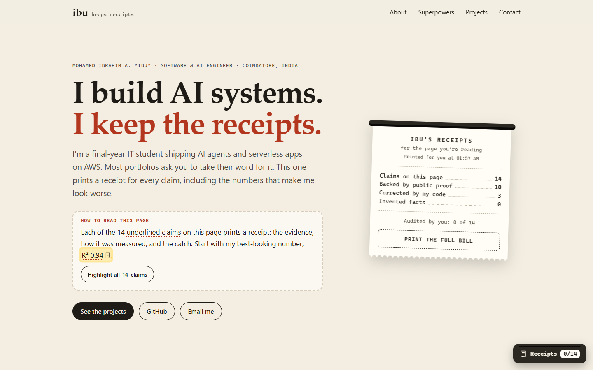
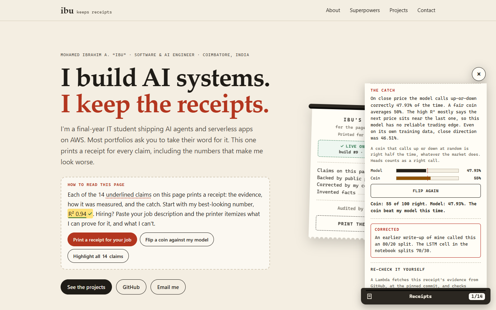
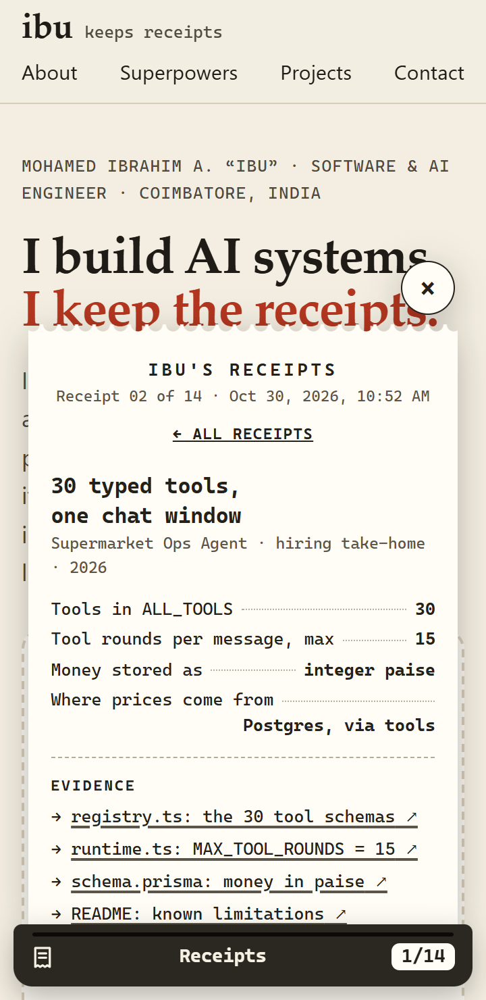
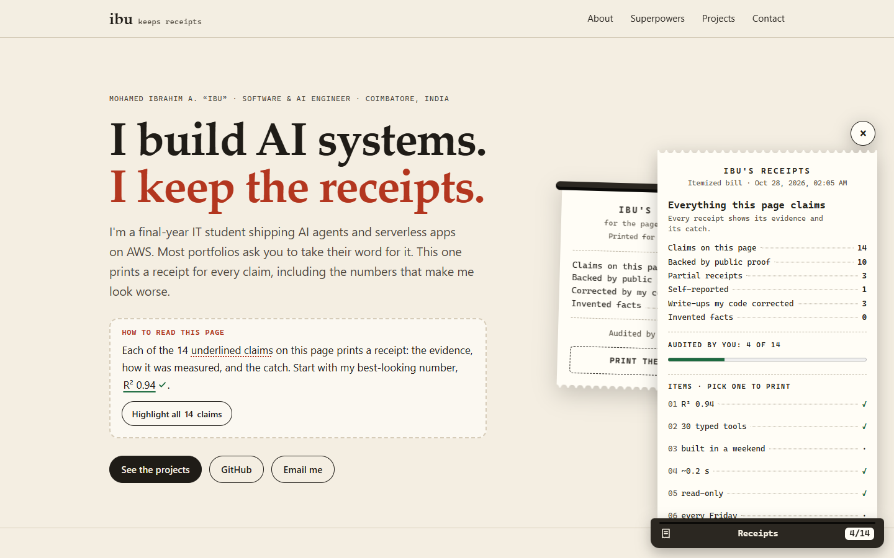
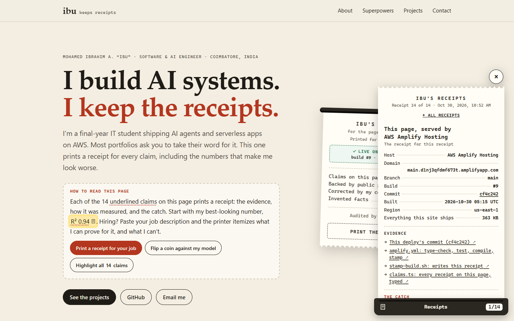
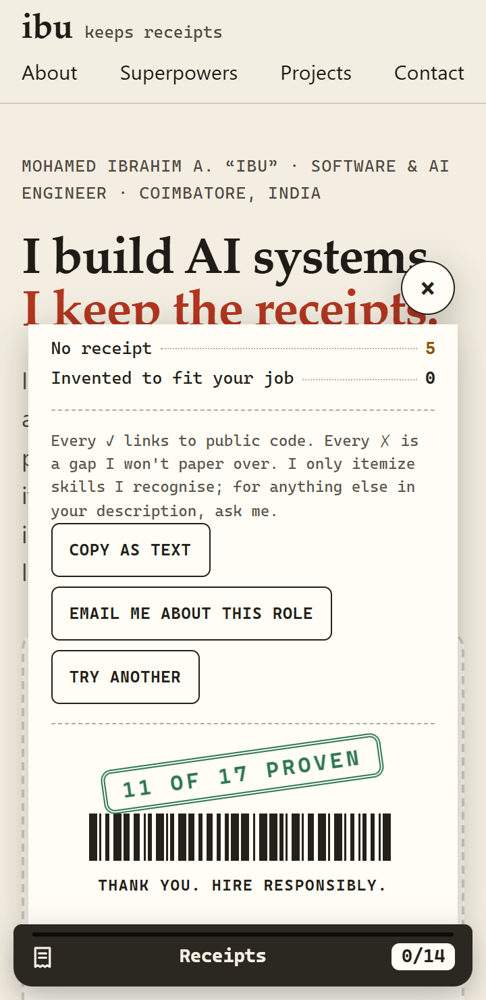

# Ibu keeps receipts

The portfolio of **Mohamed Ibrahim A. ("Ibu")**, a final-year IT student who builds AI agents and serverless apps on AWS.

**Live site:** https://main.d1nj3qfdmf673t.amplifyapp.com (AWS Amplify Hosting)
**Built for:** AWS Student Builder Challenge, “Build Your Tech Superpower” (individual entry)

*One person, two GitHub accounts: this repo lives on my main account, **MdIbuA**, but the commits show as **Ibrahimalabdullah-dev**, my second account, because that's the email my laptop's git uses. Claude Code, my coding agent, is credited as co-author on the commits it helped write.*



## What it is

A normal, readable portfolio with the three sections a recruiter expects: **About me**, **Tech superpowers** and **Projects & achievements**. On top of it sits one creative layer:

**Every underlined claim prints a receipt.**

Click a number like `R² 0.94` or `30 typed tools` and a till-style receipt feeds out of a small printer docked in the corner. Each receipt shows:

- **Evidence**: links to the exact file, line, notebook or article behind the claim
- **Measured**: how and when the number was produced
- **The catch**: the part that makes me look worse (every receipt has one)
- **Corrected**: where an earlier write-up of mine disagreed with my code
- A **stamp**: Verified, Partial or Self-reported

What else it does:

- **A receipt for your job.** Paste a job description, or pick one of three samples, and the printer itemizes it against what I can prove. Every requirement it recognises prints as **Proven** (linked to the exact file and line, at a pinned commit), **Partial** (with the reason) or **No receipt** ("I won't claim this"). It reads must-haves and nice-to-haves from the description's own headings. It runs entirely in the browser; nothing you paste is sent or saved. A closer reading by Amazon Nova Micro on Bedrock is built and tested on the [`bedrock-reader`](https://github.com/MdIbuA/ibu-receipts/tree/bedrock-reader) branch, waiting on Bedrock access for my account.
- **Coin vs. model.** A **Flip a coin against my model** button on the first screen prints the CryptoPulse receipt and flips a coin 100 times against my LSTM's 47.93% direction accuracy. The coin often wins, and the receipt says so.
- **The itemized bill.** A summary receipt with claims verified, partial and self-reported, write-ups corrected, invented facts (0), and how many receipts *you* have audited.
- **The page's own receipt.** The hero receipt shows which Amplify build and commit you're looking at (for example "Live on AWS Amplify · build #9 · commit cf4c242"). That line, and the footer claim "deployed on AWS Amplify", print a receipt the Amplify build writes at deploy time: app, branch, build number and commit. I don't write those numbers. AWS does.
- **Re-check it yourself.** Every receipt ends with **Re-check with AWS Lambda**. A Lambda behind API Gateway fetches the evidence from GitHub at the pinned commit and runs that claim's checks again, live. There are 31 checks across 13 claims. On the page's own receipt, it asks the Amplify API which build is live.

### Why this is me

My agents follow one rule: the model never invents a fact. In my Supermarket agent every price comes from Postgres through a tool. This site holds my own claims to the same rule. Building it turned up four places where my earlier write-ups disagreed with my code (a tool count, a train/test split and two model names). Those receipts print the correction. The job receipt follows the same rule: it can only point at proof that exists, and it prints the gaps.

### How visitors find it

Within the first screen: a **"How to read this page"** box that names the first claim to try and offers **Print a receipt for your job**, a **receipt stub** in the hero ("Print the full bill"), and a **printer tab** fixed in the bottom-right corner showing `0/14` audited. A **Highlight all 14 claims** button marks every claim on the page, and the Contact section offers the job receipt again.

### What it never does

It never blocks the page. The receipt panel is non-modal and docked to the side, the header navigation stays usable, and on phones the sheet closes when you tap a nav link. Without JavaScript every claim is a plain link to its evidence.

## Accessibility

- Claims become real `<button>`s with accessible names ("R² 0.94, show receipt"). Enter or Space opens a receipt, focus moves to the receipt's title, and Escape closes it and returns focus to the claim.
- The receipt panel is a labelled, non-modal `role="dialog"`; evidence links announce that they open a new tab.
- `prefers-reduced-motion` turns off the printing, stamping and nudge animations (in CSS and JS).
- Text contrast meets WCAG AA in both light and dark themes. Receipt paper stays light in both, so receipt text keeps its contrast.
- The job receipt is a labelled form (Ctrl+Enter prints). Each result line says its status in words (Proven, Partial, No receipt), never by colour or ✓/✗ alone, and every link and button keeps a 24px target (WCAG 2.2).
- The portrait has alt text; decorative icons and barcodes are `aria-hidden`.
- Tested at 360px wide, with no horizontal scrolling, and with axe: no violations of WCAG 2.2 AA or best practice, with a receipt, the job form or a job receipt open.

## Project structure

```
.
├── src/                          ← TypeScript, compiled into site/ with the same layout
│   ├── assets/site.ts            highlights the nav link for the section on screen
│   └── feature/receipts/         ← the creative feature
│       ├── types.ts              the receipts' honesty rules, as types
│       ├── claims.ts             every claim: evidence, measurement, catch, correction
│       ├── projects.ts           the repos evidence points into, each pinned to a commit
│       ├── skills.ts             114 skills a job can ask for, and the proof for each
│       ├── roles.ts              three sample job descriptions (written for the demo)
│       ├── match.ts              reads a job description; pure, so Node tests it directly
│       ├── job.ts                the job receipt's form and printout
│       ├── paper.ts, printer.ts  receipts, the bill, and the docked printer
│       └── main.ts …             wiring, re-check, coin race, the hero stub
├── site/                         ← everything Amplify publishes (baseDirectory)
│   ├── index.html                About · Superpowers · Projects & achievements · Contact
│   ├── assets/                   site.css, images (the .js is compiled, never committed)
│   └── feature/receipts/         receipts.css; build-info.js (written by the Amplify build)
├── test/                         unit tests (node:test) and type-level tests (types.check.ts)
├── scripts/
│   ├── stamp-build.sh            runs in the Amplify build; writes build-info.js and the preview URLs
│   ├── check-evidence.ts         reads every skill's evidence at its pinned commit (CI)
│   ├── serve.ts                  a zero-dependency local preview server
│   └── og/og.html                source of the 1200×630 link-preview image
├── infra/recheck/                the re-check API: SAM template + Lambda (src/app.py)
├── .github/workflows/ci.yml      type-check, test, build and evidence check on every push
├── amplify.yml                   Amplify build spec: type-check, test, compile, stamp
├── customHttp.yml                security headers, incl. a strict content security policy
├── tsconfig.json                 strict TypeScript 7, emitting plain ES modules
├── docs/screenshots/             submission screenshots (see SCREENSHOTS.md)
├── DEPLOY.md                     exact console clicks for Amplify Hosting
├── AWS.md                        AWS services used and what to look for in the console
├── PROJECT_WRITEUP.md            the submission write-up
└── SCREENSHOTS.md                the screenshot checklist
```

## How the code holds itself to the rules

The site is TypeScript 7 under every strict flag, compiled by `tsc` into plain ES modules: no framework, no bundler, no runtime dependencies, no trackers. The only packages are the compiler and Node's type definitions, both used at build time only.

- **The rules are types.** A `verified` claim must cite at least one link and can't print an unproven line. A skill is `proven` only by a file or a link. Evidence can only point into a project in `projects.ts`, and a commit is a branded `Sha` that only a 40-character hash can become. `test/types.check.ts` holds dishonest receipts that must fail to compile; if a rule ever loosens, the type check fails.
- **The tests hold the page to its data** (`npm test`): every claim on the page exists in the data and the other way round, the counts printed without JavaScript match the data, every GitHub link is pinned to a commit, the content security policy's hash matches the page's one inline script, every evidence line in this repo says what it should, and the job reader handles the traps (Java vs. JavaScript, "go" the verb, React Native).
- **The evidence is re-read** (`npm run evidence`): every file the skill map points at is fetched at its pinned commit, and its line must still show the named text.
- **Nothing ships unchecked.** The Amplify build runs the type check and the tests before it compiles anything, so a broken rule stops the deploy. GitHub Actions runs the same on every push, plus the evidence check.

Everything the site ships totals about 370 KB, mostly images (my portrait and the link-preview card). A visitor's first load is about 87 KB over the wire on a desktop and 110 KB on a phone. The JavaScript is 28 KB gzipped, and the browser fetches every module at once through `modulepreload` hints.

## Run it locally

```bash
npm ci
```

```bash
npm run serve
```

`npm run serve` compiles the TypeScript and serves `site/` on http://127.0.0.1:8000. Any static server works once you've run `npm run build`, as long as it serves `.js` as JavaScript; browsers won't run ES modules otherwise. Opened straight from disk, the page still reads fine but the receipts stay plain links, because browsers don't run modules from `file://`.

`npm run check` runs the type check, the tests and the build; `npm run evidence` re-reads the evidence over the network.

To preview what the deployed site's own receipt will look like, fake the Amplify variables:

```bash
AWS_APP_ID=dtest AWS_BRANCH=main AWS_JOB_ID=1 AWS_COMMIT_ID=abc1234 bash scripts/stamp-build.sh
```

Run `git checkout site/feature/receipts/build-info.js` afterwards, so the local fallback is what you commit.

## How it's deployed

AWS Amplify Hosting is connected to this repo's `main` branch. Every push triggers a build that:

1. installs the exact TypeScript compiler from `package-lock.json` (`npm ci`, cached between builds)
2. type-checks and runs the tests; a failure stops the deploy here
3. compiles `src/` into `site/`
4. runs `scripts/stamp-build.sh`, which writes the deploy's `AWS_APP_ID`, `AWS_BRANCH`, `AWS_JOB_ID` and `AWS_COMMIT_ID` into `site/feature/receipts/build-info.js`, and fills the page's link-preview tags with the app's `amplifyapp.com` domain
5. publishes the `site/` folder to Amplify's CDN over HTTPS, with the headers from `customHttp.yml`

The re-check API is a separate SAM stack in `infra/recheck/`: an API Gateway HTTP API, one Lambda, an IAM role with one permission beyond writing its own logs, and a CloudWatch log group. Its URL reaches the site through the Amplify environment variable `VERIFY_URL`. The site never depends on it: without it, receipts just have no re-check button.

The link-preview card (`site/assets/img/og.png`) is rendered from `scripts/og/og.html` with headless Chrome. The exact command is in that file's header comment.

Step-by-step console clicks are in [DEPLOY.md](DEPLOY.md). Services and costs are in [AWS.md](AWS.md).

## Adding a claim

1. In `site/index.html`, wrap the claim in `<a class="claim" data-claim="my-id" href="EVIDENCE_URL">…</a>`. The `href` is what visitors without JavaScript get.
2. Add an entry with the same `id` to `src/feature/receipts/claims.ts`, and update the page's static counts if they change. `npm test` tells you if anything disagrees.

The one rule: **every number must be reproducible from a public link in its receipt.** If there's no public proof, mark the line `ok: false` and say so. Don't round up. The compiler won't let a `verified` receipt do otherwise.

To teach the job receipt a skill, add it to `src/feature/receipts/skills.ts` with the file, line and text that prove it (or `none()` if nothing does), then run `npm run evidence`.

Link evidence with **commit permalinks** (on GitHub, open the file and press `y`), not `blob/main`. A receipt is a frozen record: if I later edit a README, the line numbers in a `main` link would drift, but a permalink keeps pointing at what was checked.

## Screenshots

| | |
|---|---|
|  |  |
|  |  |
|  |  |

## Credits

Built with Claude Code as my coding agent (see the note at the top). Nothing here comes from a template or a third-party asset: the receipt paper, stamps, barcodes and icons are CSS and inline SVG, and the fonts are system fonts. The facts come from my own repos, each linked from its receipt. The portrait is my own photo.
