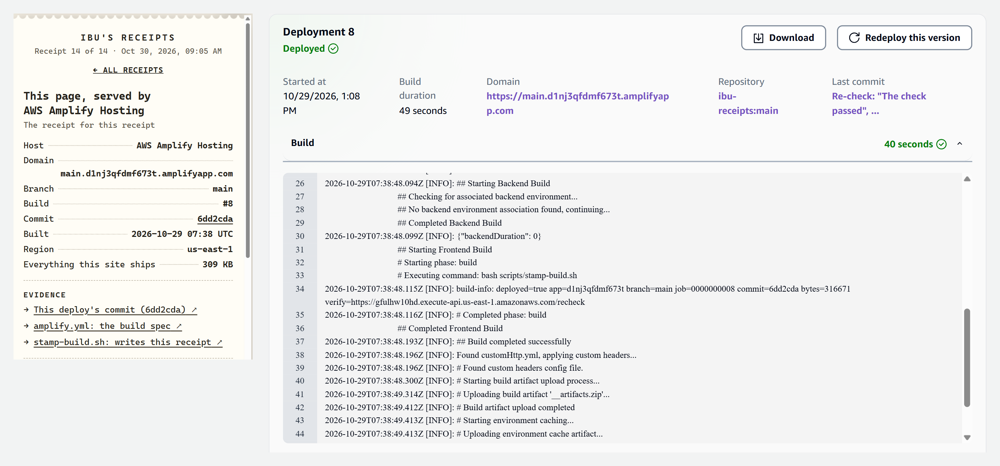

# Ibu keeps receipts

The portfolio of **Mohamed Ibrahim A. ("Ibu")**, a final-year IT student who builds AI agents and serverless apps on AWS.

**Live site:** `<LIVE_URL>` (AWS Amplify Hosting)
**Built for:** AWS Student Builder Challenge, “Build Your Tech Superpower”


## What it is

A normal, readable portfolio with the three sections a recruiter expects: **About me**, **Tech superpowers** and **Projects & achievements**. On top of it sits one creative layer:

**Every underlined claim prints a receipt.**

Click a number like `R² 0.94` or `30 typed tools` and a till-style receipt feeds out of a small printer docked in the corner. Each receipt shows:

- **Evidence**: links to the exact file, line, notebook or article behind the claim
- **Measured**: how and when the number was produced
- **The catch**: the part that makes me look worse (every receipt has one)
- **Corrected**: where an earlier write-up of mine disagreed with my code
- A **stamp**: Verified, Partial or Self-reported

Three extras:

- **Coin vs. model.** The CryptoPulse receipt lets you flip a coin 100 times against my LSTM's 47.93% direction accuracy. The coin often wins, and the receipt says so.
- **The itemized bill.** A summary receipt with claims verified, partial and self-reported, write-ups corrected, invented facts (0), and how many receipts *you* have audited.
- **The page's own receipt.** The footer claim "deployed on AWS Amplify" prints a receipt the Amplify build writes at deploy time: app, branch, build number and commit. I don't write those numbers. AWS does.

### Why this is me

My agents follow one rule: the model never invents a fact. In my Supermarket agent every price comes from Postgres through a tool. This site holds my own claims to the same rule. Building it turned up three places where my earlier write-ups disagreed with my code (a tool count, a train/test split, a model name). Those receipts print the correction.

### How visitors find it

Within the first screen: a **"How to read this page"** box that names the first claim to try, a **receipt stub** in the hero ("Print the full bill"), and a **printer tab** fixed in the bottom-right corner showing `0/14` audited. A **Highlight all 14 claims** button marks every claim on the page.

### What it never does

It never blocks the page. The receipt panel is non-modal and docked to the side, the header navigation stays usable, and on phones the sheet closes when you tap a nav link. Without JavaScript every claim is a plain link to its evidence.

## Accessibility

- Claims become real `<button>`s with accessible names ("R² 0.94, show receipt"). Enter or Space opens a receipt, focus moves to the receipt's title, and Escape closes it and returns focus to the claim.
- The receipt panel is a labelled, non-modal `role="dialog"`; evidence links announce that they open a new tab.
- `prefers-reduced-motion` turns off the printing, stamping and nudge animations (in CSS and JS).
- Text contrast meets WCAG AA in both light and dark themes. Receipt paper stays light in both, so receipt text keeps its contrast.
- The portrait has alt text; decorative icons and barcodes are `aria-hidden`.
- Tested at 360px wide, with no horizontal scrolling.

## Project structure

```
.
├── site/                         ← everything Amplify publishes (baseDirectory)
│   ├── index.html                About · Superpowers · Projects & achievements · Contact
│   ├── assets/
│   │   ├── site.css              paper-and-ink base styles, light + dark, responsive
│   │   ├── site.js               highlights the nav link for the section on screen
│   │   └── img/                  portrait (webp + jpg), favicon.svg, og.png (link preview)
│   └── feature/receipts/         ← the creative feature, self-contained
│       ├── claims.js             every claim: evidence, measurement, catch, correction
│       ├── receipts.js           turns claims into buttons; prints receipts and the bill
│       ├── receipts.css          printer, paper, stamps, barcode, coin race
│       └── build-info.js         written by the Amplify build (local fallback committed)
├── scripts/
│   ├── stamp-build.sh            runs in the Amplify build; writes build-info.js and the preview URLs
│   └── og/og.html                source of the 1200×630 link-preview image
├── amplify.yml                   Amplify build spec
├── docs/screenshots/             submission screenshots (see SCREENSHOTS.md)
├── DEPLOY.md                     exact console clicks for Amplify Hosting
├── AWS.md                        AWS services used and what to look for in the console
├── PROJECT_WRITEUP.md            the submission write-up
├── SCREENSHOTS.md                the screenshot checklist
└── RUBRIC_AUDIT.md               self-scored against the judging rubric
```

No framework, no build step, no dependencies, no trackers. Everything the site ships totals about 300 KB, mostly images (my portrait and the link-preview card). A visitor's first load is about 42 KB over the wire.

## Run it locally

Any static server works:

```bash
python -m http.server 8000 --directory site
```

Then open http://localhost:8000. Opening `site/index.html` straight from disk also works; the scripts are plain `<script defer>` files with no `fetch`.

To preview what the deployed site's own receipt will look like, fake the Amplify variables:

```bash
AWS_APP_ID=dtest AWS_BRANCH=main AWS_JOB_ID=1 AWS_COMMIT_ID=abc1234 bash scripts/stamp-build.sh
```

Run `git checkout site/feature/receipts/build-info.js` afterwards, so the local fallback is what you commit.

## How it's deployed

AWS Amplify Hosting is connected to this repo's `main` branch. Every push triggers a build that:

1. runs `scripts/stamp-build.sh`, which writes the deploy's `AWS_APP_ID`, `AWS_BRANCH`, `AWS_JOB_ID` and `AWS_COMMIT_ID` into `site/feature/receipts/build-info.js`, and fills the page's link-preview tags with the app's `amplifyapp.com` domain
2. publishes the `site/` folder to Amplify's CDN over HTTPS

The link-preview card (`site/assets/img/og.png`) is rendered from `scripts/og/og.html` with headless Chrome. The exact command is in that file's header comment.

Step-by-step console clicks are in [DEPLOY.md](DEPLOY.md). Services and costs are in [AWS.md](AWS.md).

## Adding a claim

1. In `site/index.html`, wrap the claim in `<a class="claim" data-claim="my-id" href="EVIDENCE_URL">…</a>`. The `href` is what visitors without JavaScript get.
2. Add an entry with the same `id` to `site/feature/receipts/claims.js`.

The one rule: **every number must be reproducible from a public link in its receipt.** If there's no public proof, mark the line `ok: false` and say so. Don't round up.

Link evidence with **commit permalinks** (on GitHub, open the file and press `y`), not `blob/main`. A receipt is a frozen record: if I later edit a README, the line numbers in a `main` link would drift, but a permalink keeps pointing at what was checked.

## Screenshots

| | |
|---|---|
|  |  |
|  |  |

## Credits

All code, copy and art are original: the receipt paper, stamps, barcodes and icons are CSS and inline SVG, and the fonts are system fonts. The portrait is my own photo.
